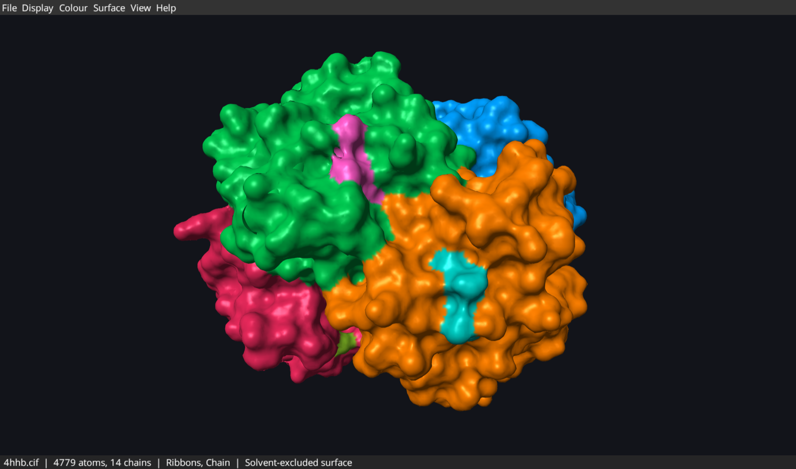
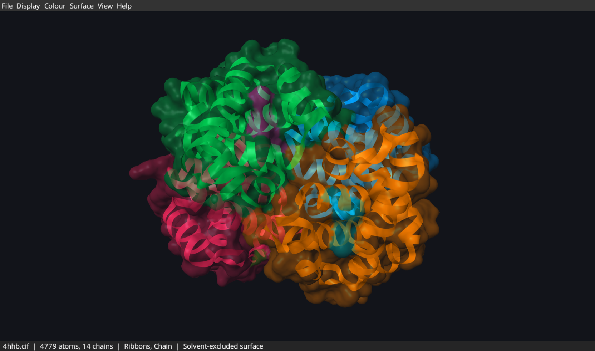
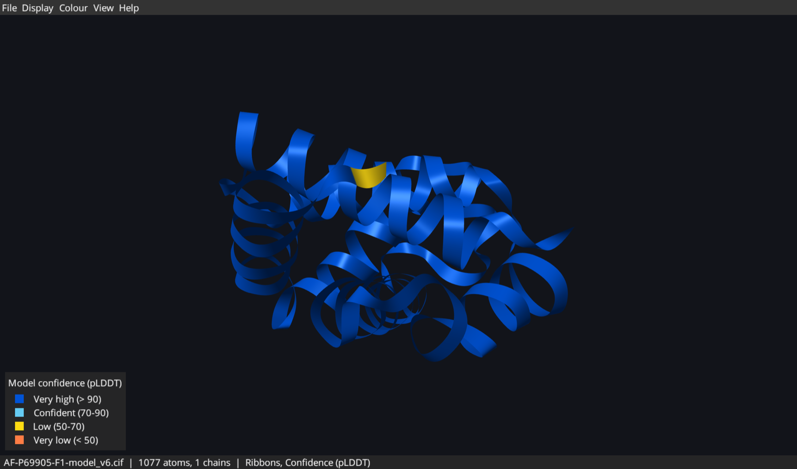
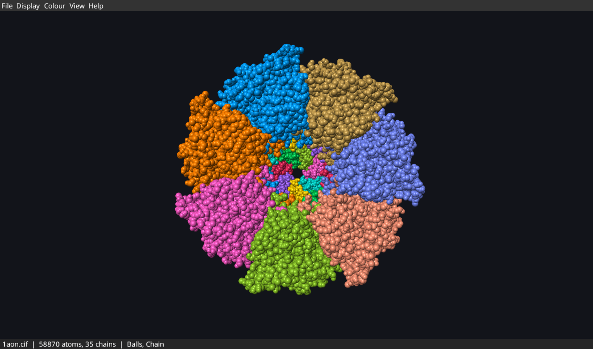
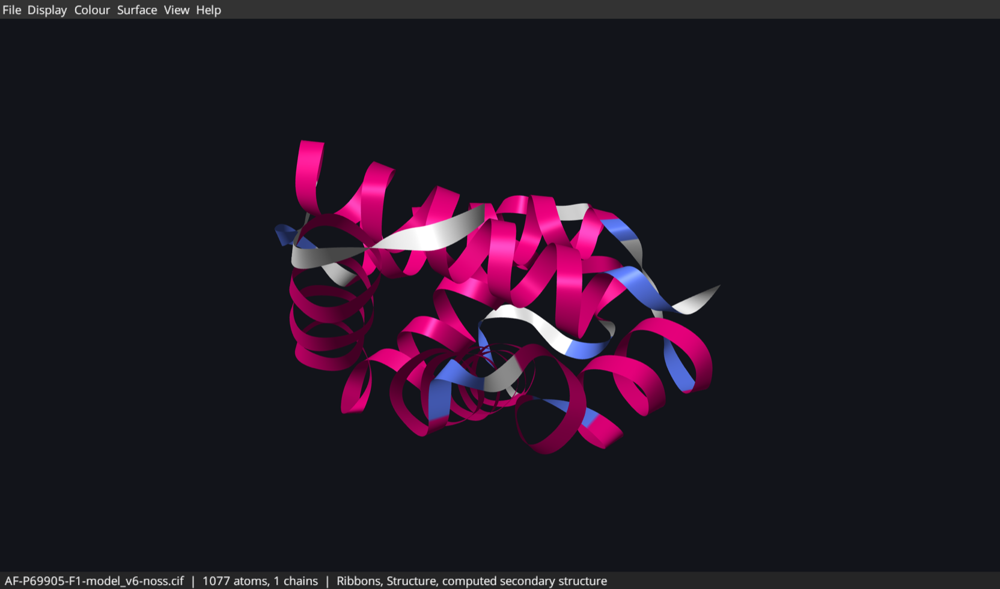
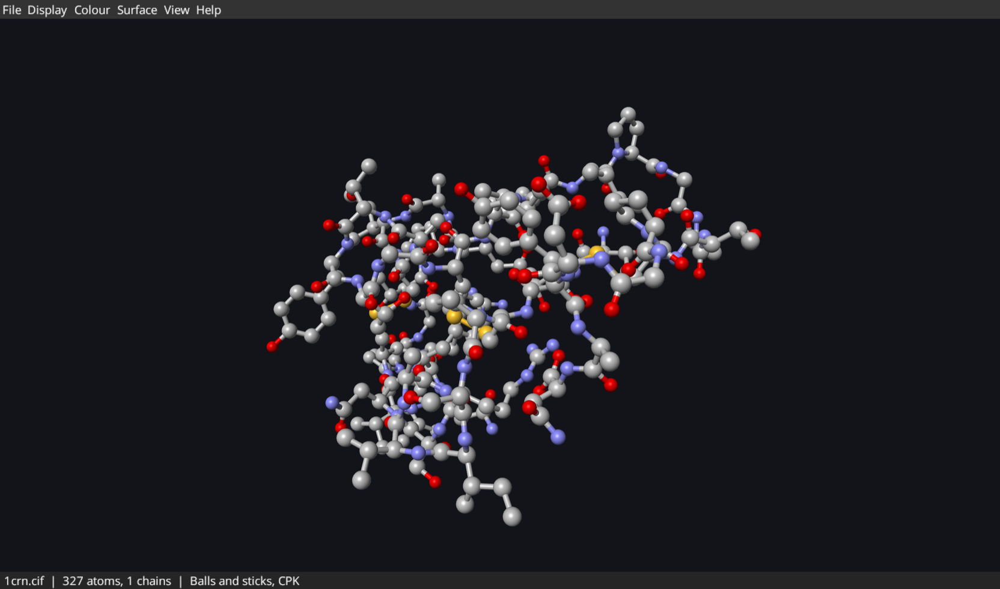
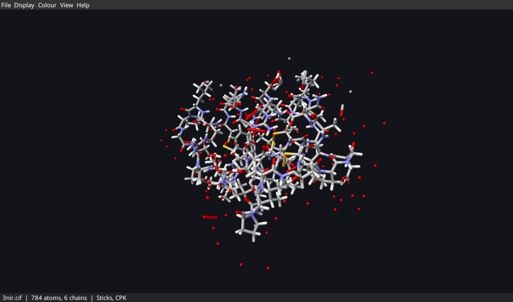
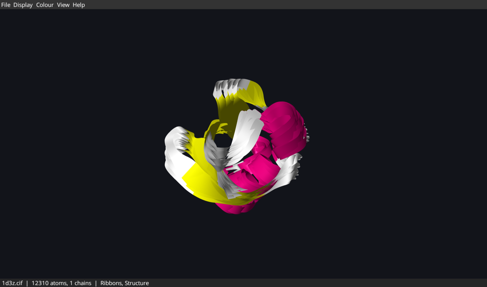
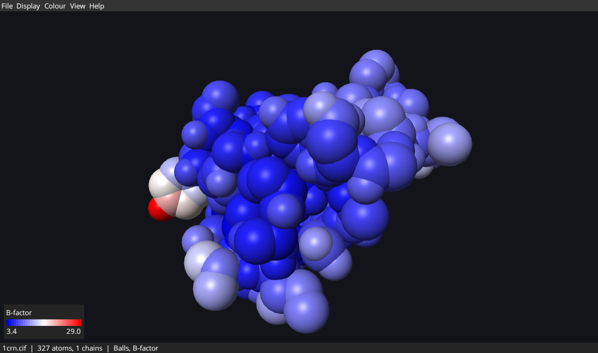

# JMVS: Java Molecular Visualisation System

A [RasMol](http://www.openrasmol.org/)-like 3D viewer for macromolecular structures, for macOS, Windows and Linux.
Open a PDBx/mmCIF file, then rotate it, show it as balls, sticks or ribbons, wrap it in a molecular surface, and
colour it by element, chain, residue, secondary structure, B-factor or AlphaFold confidence.

<table>
  <tr>
    <td align="center" valign="top" width="33%">
       
      <b>Molecular surface</b> Haemoglobin (<code>4hhb</code>), solvent-excluded surface coloured by chain, built in about 0.25 s
    </td>
    <td align="center" valign="top" width="33%">
       
      <b>Transparent surface over ribbons</b> Any display mode shows through a surface at 70% or 40% opacity
    </td>
    <td align="center" valign="top" width="33%">
       
      <b>AlphaFold confidence</b> Predicted model in ribbons, coloured by pLDDT in the AlphaFold DB bands, with a legend
    </td>
  </tr>
  <tr>
    <td align="center" valign="top" width="33%">
       
      <b>Balls, at scale</b> GroEL–GroES (<code>1aon</code>): 58,870 atoms in 35 chains, rotating smoothly
    </td>
    <td align="center" valign="top" width="33%">
       
      <b>Computed secondary structure</b> Ribbons of an AlphaFold model with no annotation in the file: helices and turns assigned from backbone hydrogen bonds
    </td>
    <td align="center" valign="top" width="33%">
       
      <b>Balls and sticks</b> Crambin (<code>1crn</code>) in RasMol's CPK element colours
    </td>
  </tr>
  <tr>
    <td align="center" valign="top" width="33%">
       
      <b>Sticks</b> Crambin at 0.48 Å (<code>3nir</code>) with its hydrogens in white
    </td>
    <td align="center" valign="top" width="33%">
       
      <b>NMR ensembles</b> Ubiquitin (<code>1d3z</code>): all 10 NMR models overlaid
    </td>
    <td align="center" valign="top" width="33%">
       
      <b>B-factor</b> Crambin coloured by B-factor, from blue (low) to red (high)
    </td>
  </tr>
</table>

*Click a picture for the full-size screenshot. All structures are in [`data/`](data/README.md).*

## Features

**Display**
* Four display modes: balls (space-filling), sticks, balls and sticks, and ribbons (Carson–Bugg).
* Molecular surfaces, solvent-excluded or solvent-accessible, drawn over any display mode, opaque or transparent.
  They are computed in the background: haemoglobin takes about a quarter of a second, the 59,000-atom `1aon`
  1–2 seconds.
* Colour schemes: CPK (element), chain, group (residue), secondary structure, B-factor, and confidence (pLDDT) for
  AlphaFold and other predicted models, with a colour legend. Every scheme works with every mode and with surfaces,
  except CPK for ribbons.

**Structures**
* PDBx/mmCIF files, plain, gzipped (`.cif.gz`) or BinaryCIF (`.bcif`), read with RCSB's
  [ciftools-java](https://github.com/rcsb/ciftools-java).
* Covalent bonds inferred with RasMol's rules; helices, sheets and turns read from the file and applied per chain,
  or computed from backbone hydrogen bonds (a DSSP subset) when the file has none, as in predicted models. The
  *Display* menu or `--ss` chooses *Auto*, *From file* or *Computed*.
* Hydrogens, alternate atom positions (one kept per atom) and multi-model NMR files (models drawn overlaid).

**Interaction**
* Rotate, zoom, pan and reset the view; click an atom to highlight it and see its element, residue, chain,
  coordinates and B-factor or pLDDT.
* Open files with the native dialog or by dropping them on the window. Files load in the background, so the window
  stays responsive, and a bad file shows an error instead of closing the app.

**Performance**
* GPU instancing: a 20,000-atom structure (`1zpd`) rotates at 96 fps in balls mode and faster in the others, and the
  59,000-atom `1aon` at 43 fps (Apple Silicon Mac, Retina resolution).
* Changing colour scheme only updates colours; geometry is never rebuilt for it.

## Installing

Download the installer for your OS from the [latest release](https://github.com/PorridgeBear/jmvs/releases/latest):
`.dmg` (macOS), `.msi` (Windows) or `.deb` (Debian/Ubuntu). They include Java, so nothing else is needed.

The installers are not signed. On macOS, if JMVS "cannot be opened", go to System Settings > Privacy & Security and
choose *Open Anyway* (or run `xattr -dr com.apple.quarantine /Applications/JMVS.app`). On Windows, choose *More info*
then *Run anyway* if SmartScreen warns about the installer.

## Building and running

You need any JDK from 17 to 27 to run Gradle; Gradle downloads the JDKs it compiles with.

To build and test:

	./gradlew build

To run (optionally with a file; you can also use File > Open or drop a file on the window):

	./gradlew :jmvs-app:run --args="data/1crn.cif"

Controls: left-drag rotates, right-drag or scroll zooms, middle-drag or Shift+left-drag pans, click selects an atom,
R resets the view, Esc clears the selection.

Options choose the view from the command line, or render one screenshot or measure the frame rate and exit:

	jmvs [file] [--mode <id>] [--scheme <id>] [--ss auto|file|computed] [--surface ses|sas]
	     [--surface-opacity <0-1>] [--screenshot <png>] [--benchmark <seconds>]

Mode ids are `balls`, `sticks`, `ballsandsticks` and `ribbons`; scheme ids are `cpk`, `chain`, `group`, `structure`,
`bfactor` and `confidence`. `--ss` chooses where secondary structure comes from: the file's annotation if it has
any (`auto`, the default), the file only, or computed. For example, after `./gradlew :jmvs-app:installDist`:

	jmvs-app/build/install/jmvs/bin/jmvs data/4hhb.cif --mode ribbons --scheme chain --surface ses --screenshot 4hhb.png

To build a native installer with a bundled Java runtime (`.dmg`, `.msi` or `.deb` for the current OS):

	./gradlew :jmvs-app:jpackage

## Documentation

* [Architecture](docs/README.md): arc42 documentation and [architecture decision records](docs/adr/README.md).
* [Roadmap](docs/roadmap.md): planned features, in order, with their status.
* [Sample data](data/README.md): what each structure in `data/` is for.
* [AGENTS.md](AGENTS.md): conventions for contributors and AI coding agents.

## History

JMVS began in 1999 as a Computer Science dissertation: a RasMol-like viewer in Java3D. It was reworked in 2003 and
2022, and in 2026 it was modernised onto Java 25 and libGDX with AI assistance. [LEGACY.md](LEGACY.md) has the full
story, how the modernisation was done, and side-by-side screenshots against the 2022 version. The original app is
kept in [`legacy-app/`](legacy-app/).
