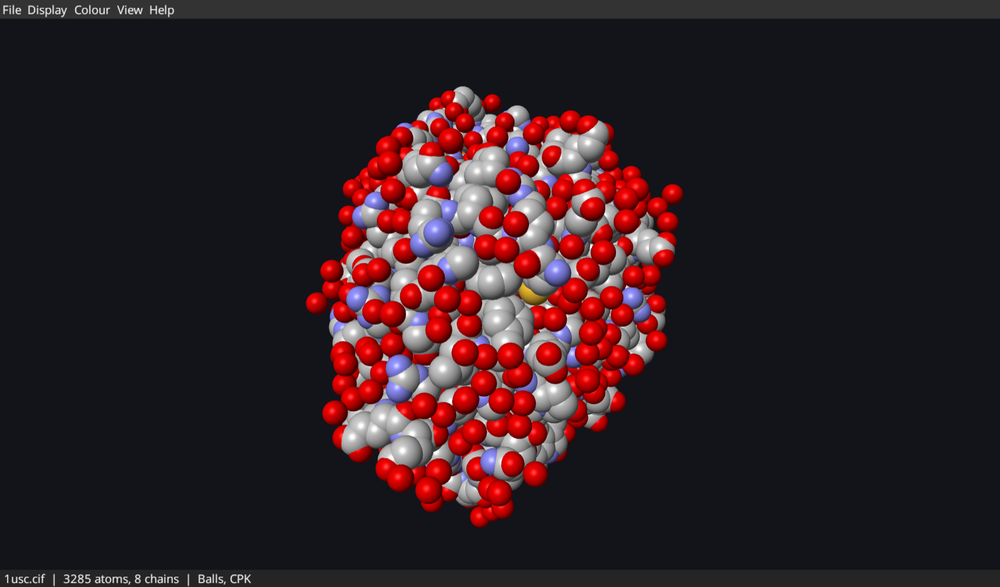
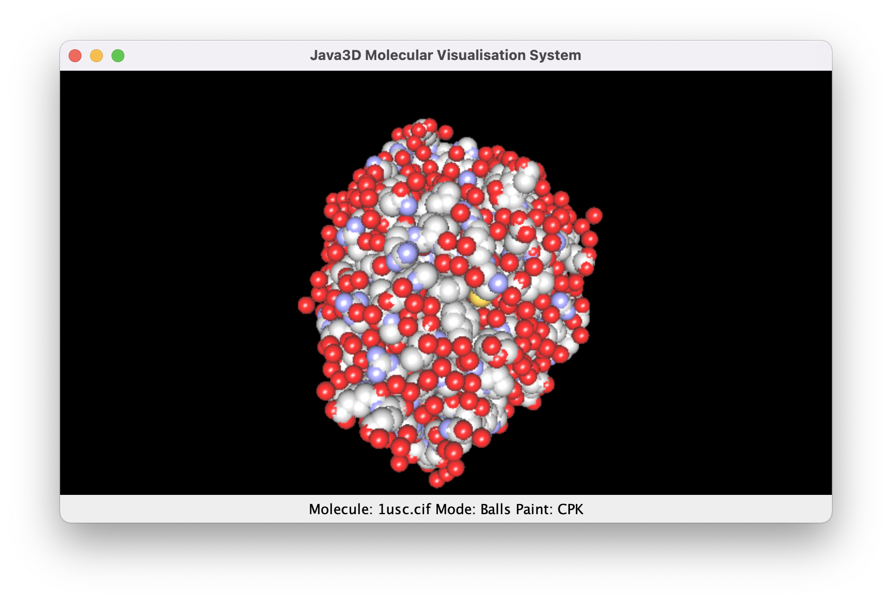
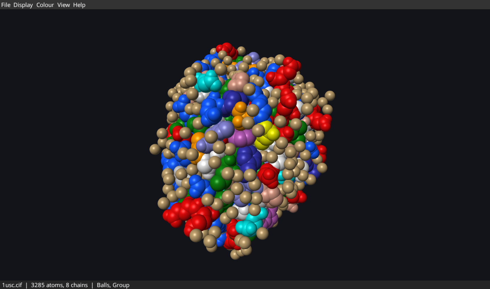
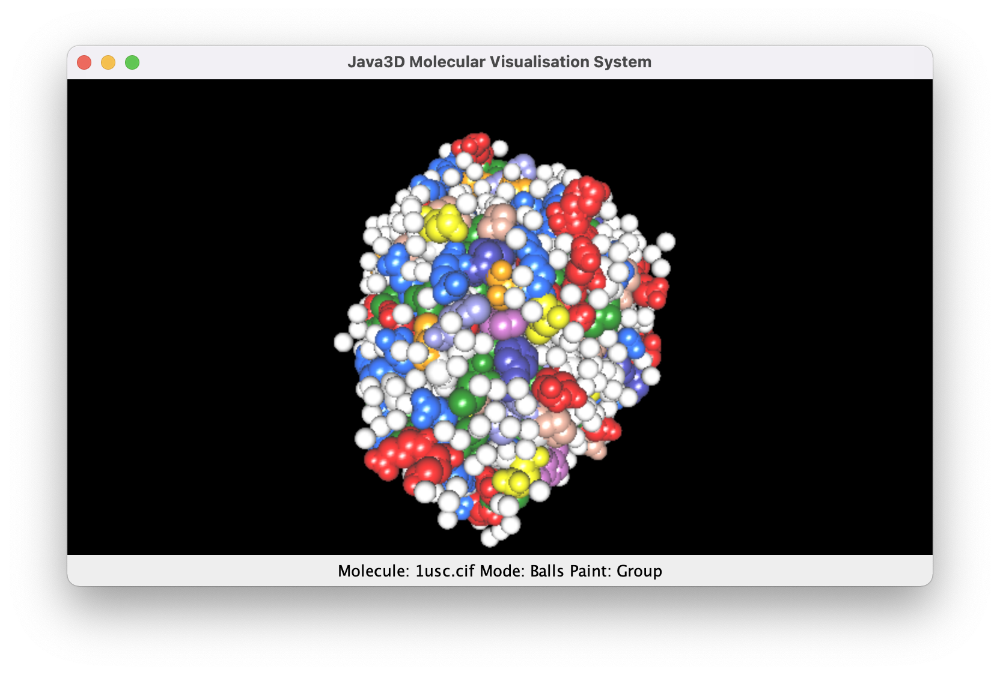
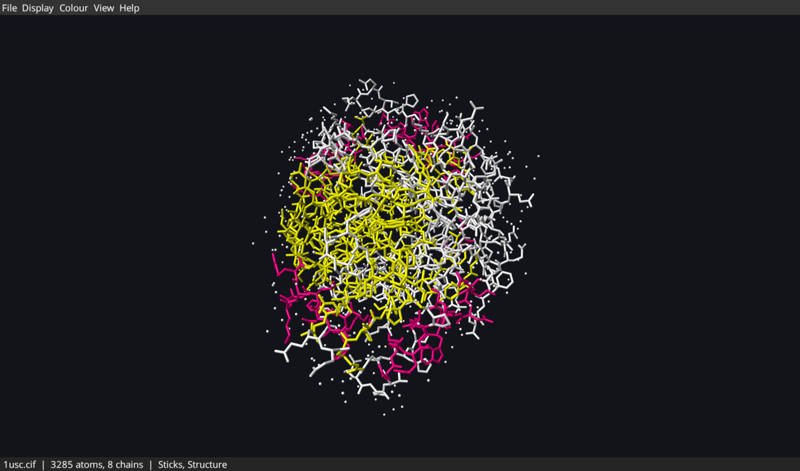
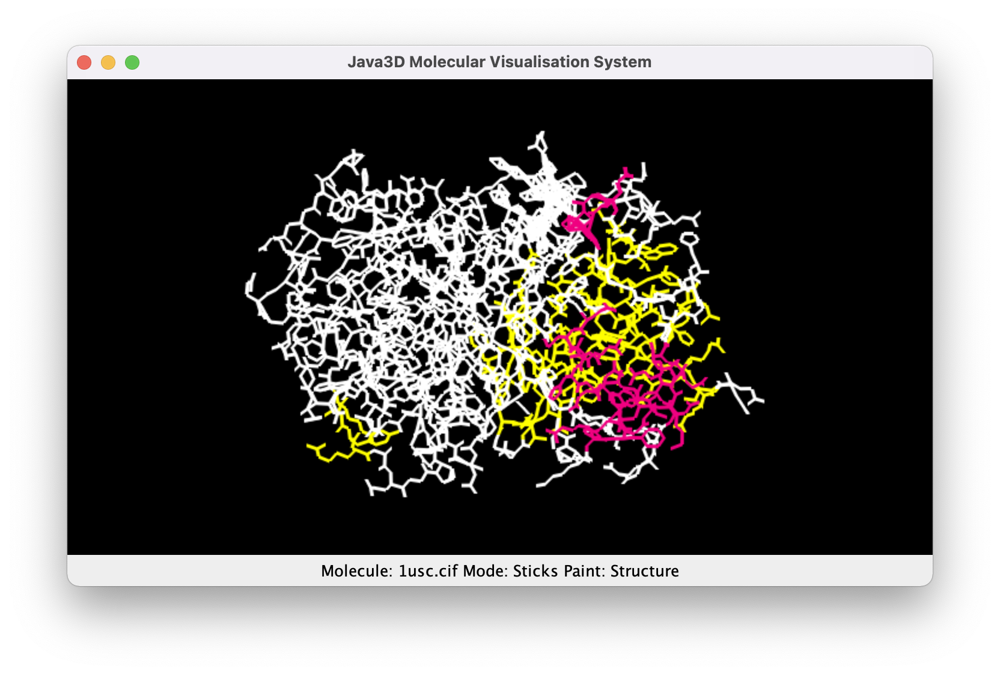
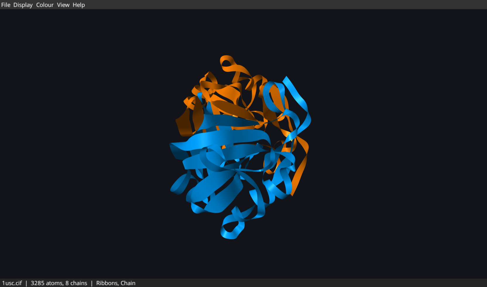
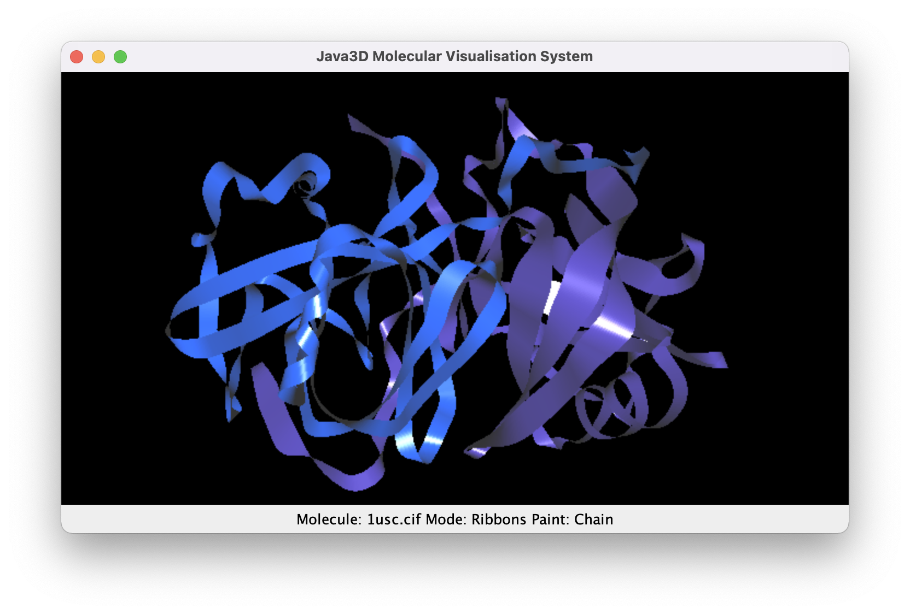
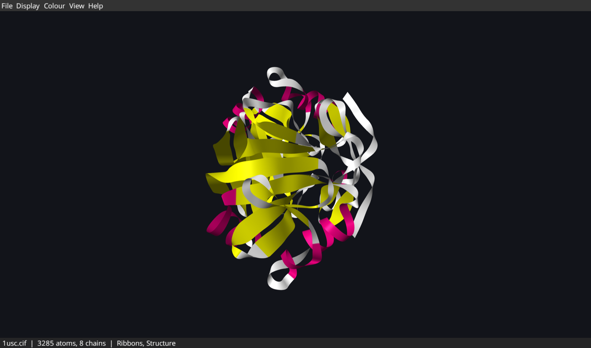
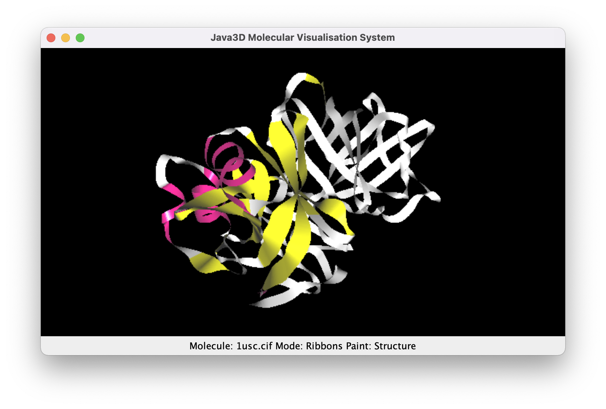

# Java3D Molecular Visualisation System (JMVS)

| 2026 | 2022 |
|---|---|
|  |  |
|  |  |
|  |  |
|  |  |
|  |  |

*`1usc.cif` from [`data/`](data/), rendered by the 2026 libGDX version (left) and the 2022 Java3D version (right).*

## 2026

JMVS has been modernised: Java 25, a multi-module Gradle 9 build, and [libGDX](https://libgdx.com/) in place of
Java3D, so it no longer depends on hand-picked JARs. Structures load with RCSB's
[ciftools-java](https://github.com/rcsb/ciftools-java), bonding uses a spatial grid with the same RasMol rules, and
atoms are drawn with GPU instancing.

### What's better than 2022

**Performance**
* A 20,000-atom structure (`1zpd`) rotates at 96 fps in balls mode, and faster in the other modes (Apple Silicon Mac,
  Retina resolution). The 2022 version struggled from around 1,000 atoms.
* Bonding no longer compares every pair of atoms: loading and bonding `1zpd` takes about 0.1–0.2 s.
* Changing the colour scheme only updates colours instead of rebuilding the whole scene.
* Files load in the background, so the window stays responsive.

**Features**
* Balls and sticks mode is back, and every colour scheme works in every mode (except CPK for ribbons).
* Turns are read and coloured in structure mode.
* Click an atom to highlight it and see its element, residue, chain and coordinates.
* Pan and reset the view, open files with the native dialog or by dropping them on the window, and read `.cif.gz`
  and BinaryCIF files.
* Builds for macOS, Windows and Linux, with native installers that bundle Java. So far only the macOS one has
  been tried.

**Correctness**
* Helices and sheets are applied only to their own chain. Previously they were matched by residue number across
  all chains, so multi-chain structures were coloured wrongly.
* The bounds and centring maths is fixed, and model numbers no longer have to start at 1.
* The mmCIF reading handles quoted and multi-line values, and keeps one position per atom where a file lists
  alternatives, so those atoms are no longer duplicated.
* Bonds are tested to be exactly those of the original RasMol-style rules on every sample file.
* Chain colours are the same every run (they were random), and Asn/Gln are cyan as the colour table intended.

**Robustness and maintainability**
* A bad file shows an error and the app keeps running. In 2022 the app simply exited.
* No more console output per atom and per bond, and no dependence on the directory the app is started from.
* 46 automated tests, plus a GitHub Actions workflow to run them on macOS, Windows and Linux.
* Rendering is separated from the molecule model, so display modes are easy to add.
* There are no copied third-party sources or JARs in the new code, and dependency checksums are verified.
* The architecture and the decisions behind it are documented (see below).

### How it was modernised

I want to be open about this: the modernisation was done with GitHub Copilot, using Claude Opus 5.5, in three steps.

1. **Establish a baseline.** Before changing anything, I had Copilot reverse-engineer the existing code into
   retrofit architecture docs: [arc42](docs/arc42/legacy/) and [ADRs](docs/adr/legacy/README.md) describing the
   system as it was. Anything not evident from the code or this README is marked *[Inferred]* or *[Assumption]*.
   The risks and technical debt section (Java3D lock-in, macOS-only vendored JARs, O(n²) bonding, `System.exit` on
   bad input, and so on) became the to-do list for everything that followed.
2. **Plan, with my steering.** In Copilot's plan mode, using those docs and the sources, I worked through a
   [modernisation plan](docs/modernisation.md). Copilot asked about the key decisions and I made the calls. These
   included:
   - Java 25 LTS rather than 21.
   - libGDX as the 3D engine. Copilot offered JavaFX 3D, jMonkeyEngine, raw LWJGL, or Java3D 1.7 as a stepping
     stone.
   - RCSB's ciftools-java for loading structures, instead of hardening my own CIF parser or adopting BioJava.
   - A multi-module build.
   - Keeping the old app running side by side until the new one matches it.
   - Built-in display modes rather than drop-in plugin JARs.
   - CI, native installers, a performance target, and atom picking as extras.

   The plan also produced new [ADRs](docs/adr/README.md) and [arc42 docs](docs/README.md) for the target
   architecture, plus an [AGENTS.md](AGENTS.md) for future coding agents.
3. **Implement on autopilot.** I then let Copilot implement all the phases: build, core, scene, renderer, app,
   packaging. It checked its own work as it went: unit tests, golden-file tests, and checking the new bonding
   against the old all-pairs version on every sample file. It also rendered every mode to screenshots and viewed
   them, benchmarked frame rates, and ran a separate code-review agent, which found a real bug that was then fixed.
   Where reality differed from the plan (for example, needing a newer LWJGL for Java 25, or macOS threading), the
   ADRs were updated to say so.

What's left is in [docs/modernisation.md](docs/modernisation.md): running CI and the installers on Windows and
Linux, and then retiring the original Java3D app in `legacy-app/`. Tag `legacy-java3d` marks the code as it was
before all this.

### Building and running

You need any JDK from 17 to 27 to run Gradle; Gradle downloads the JDKs it compiles with.

To build and test:

	./gradlew build

To run (optionally with a file; you can also use File > Open or drop a file on the window):

	./gradlew :jmvs-app:run --args="data/1crn.cif"

Controls: left-drag rotates, right-drag or scroll zooms, middle-drag or Shift+left-drag pans, click selects an atom,
R resets the view.

To build a native installer with a bundled Java runtime (`.dmg`, `.msi` or `.deb` for the current OS):

	./gradlew :jmvs-app:jpackage

The legacy app still runs on macOS with `./gradlew :legacy-app:run`.

## 2022

Recently, I found the refactored Java source code on a hard drive and thought I'd upload it to my github account 
for posterity. Before doing that though I wanted to ensure it built and ran. 

Getting the sources to build and run on my Apple M1 with ARM processor was a headache but I managed to find some JARs
that somebody had compiled for the M1.

I added a basic gradle configuration to be able to easily build and run the sources.

To build:

	gradle build

To run:

	gradle run

Note, you'll need to add the appropriate JARs for gluegen and jogl for your architecture to app/libs.

*(2026: this version now lives in `legacy-app/` and runs with `./gradlew :legacy-app:run`; see 2026 above.)*

### New additions

I also couldn't resist doing some tinkering (helps with some Java practice):

* The molecular loader has been replaced with an all-new loader for the latest PDBx/mmCIF type and loads atoms, sheets and helices
* I improved the auto-covalent bond routine to match RasMol's implementation
* Ribbons now has colour modes; Chain, Group and Structure - finally, and with better shading
* Ribbons helices/sheet size improvements, though not yet arrow shapes for sheets
* Added chain and structure colouring to balls and sticks modes

### The Java

The majority of Java here is quite old, pre-8 style. I'd like to update to more modern Java, though Java 11 appears to 
be the latest that will support the JARs that are provided here.

## 2014

For fun, I decided to learn Swift with its 3D SceneKit library and ported some of JMVS to 
[iMVS](https://github.com/PorridgeBear/imvs), which has a roadmap that perhaps one day I'll tinker with further.

## 2003

A few years later in 2003, having worked professionally as a Java developer, I refactored the source code 
around a plugin-oriented idea, more configurable, though never took this idea to its full extent, i.e. 3rd parties
being able to drop in plugin jars containing new modes/colouring, for instance.

I also finally added ["ribbons"](https://en.wikipedia.org/wiki/Ribbon_diagram) mode, based on 
Mike Carson and Charles E Bugg's (Algorithm for ribbon models of proteins)[https://www.sciencedirect.com/science/article/abs/pii/0263785586800108] 
which I never quite managed for the dissertation version.

JMVS never achieved the performance or feature set of RasMol or other software in this space, but it was a project 
that helped me learn some biochemistry, some C, 3D programming and creating a desktop software user experience, 
which were all very interesting and informative.

## 1999

JMVS was built back in 1998/99 for my Computer Science dissertation whose aim was to create 
a [RasMol](http://www.openrasmol.org/)-like 3D molecular viewer in Java. Java3D had just come about which abstracted 
low level OpenGL to a more abstract Scene Graph approach, though lower level primatives were possible. 

I recall RasMol's source code, written in C, being quite difficult to understand in detail 
(perhaps why I am now a huge proponent of code commenting, self-explanatory variable naming etc.), though I'd never 
seen C before either, my degree focusing mainly on Java, and so that was half the battle. 

However, I managed to find a way through to creating a tool that allowed for 3 graphics modes; balls, sticks and balls 
and sticks, and amino and atom colouring, with zoom and rotation. Performance was an issue once atom count got to, 
I recall, around 1000.
