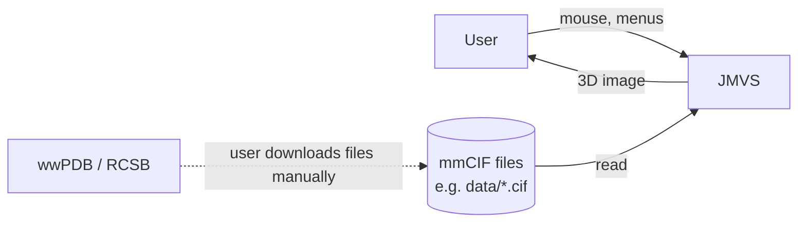
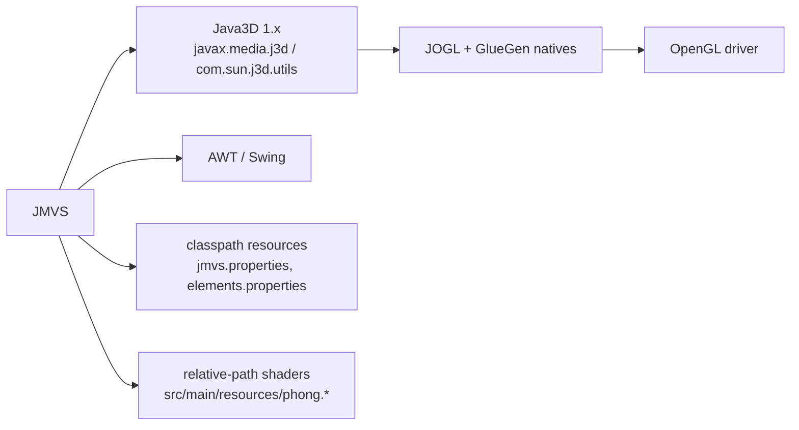

# 03 Context and scope

## Business context

| Partner | Interaction |
|---|---|
| User | Loads files, picks mode/paint, rotates/zooms |
| mmCIF files | Local files chosen via `FileDialog`; samples in `data/` (1crn, 1usc, 1zpd, 6l1f; the `.gz` variant is not read by the loader) |
| wwPDB | Source of files and format spec; **no network access** from the app |

## Technical context

No network, database, or inter-process interfaces. Inputs: file dialog, mouse. Outputs: on-screen render, stdout (verbose logging).
