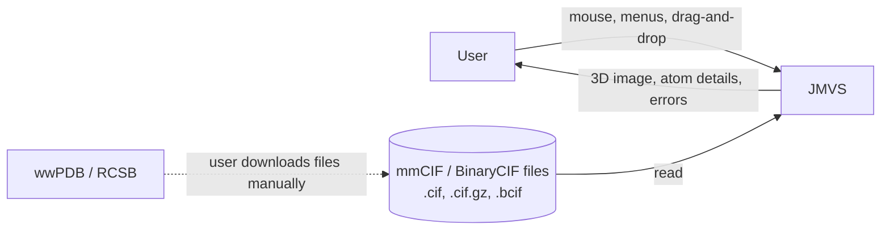
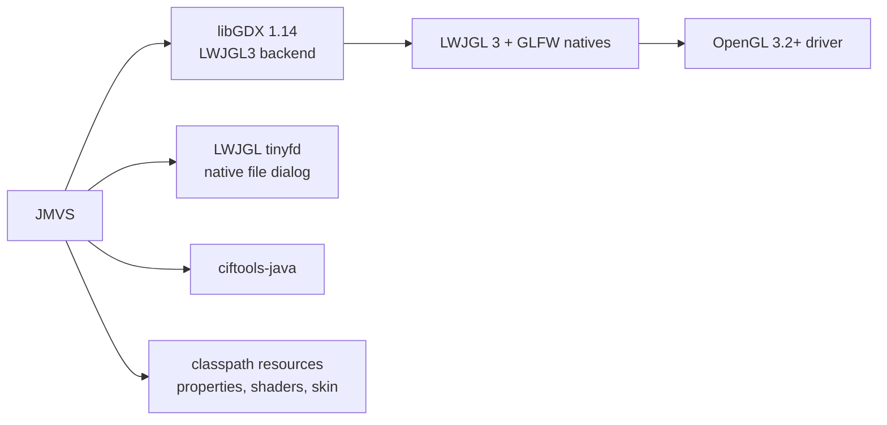

# 03 Context and scope

## Business context

| Partner | Interaction |
|---|---|
| User | Opens files, chooses display mode and colour scheme, rotates/zooms/pans, picks atoms |
| Structure files | Local files chosen via the native dialog or dropped on the window; samples in `data/` |
| wwPDB / RCSB | Source of files and format definitions; no network access from the app |

## Technical context

No network, database or inter-process interfaces. Inputs: files, mouse, keyboard. Outputs: on-screen rendering and log messages via `System.Logger`.
