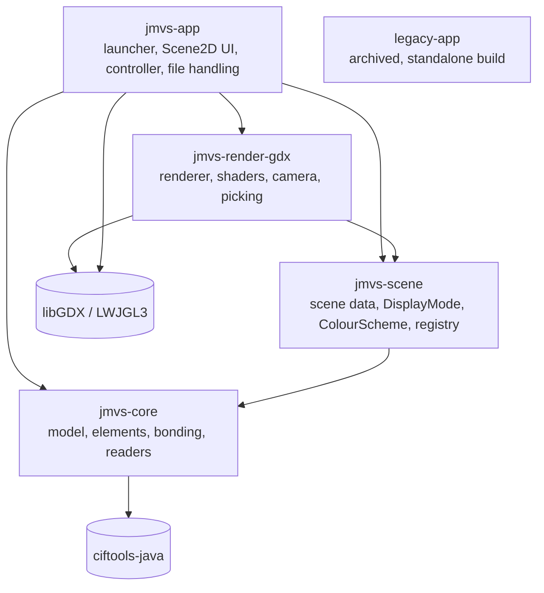
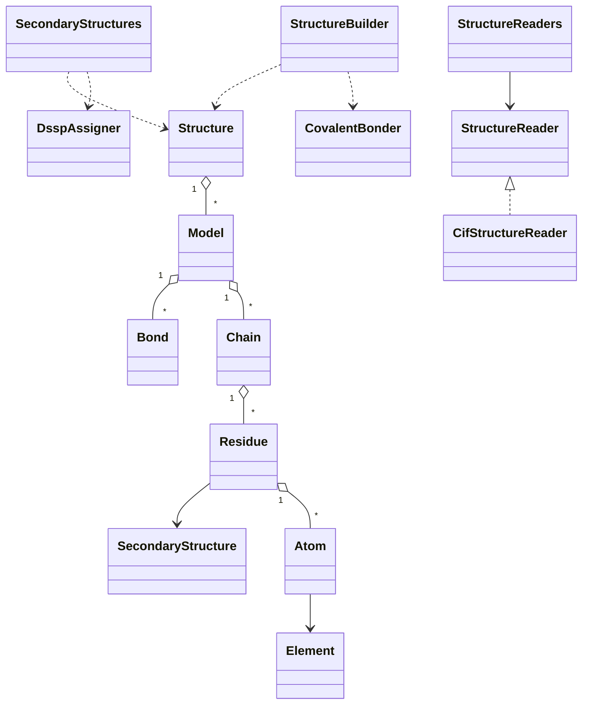

# 05 Building block view

## Level 1 — modules

| Module | Responsibility | Key packages |
|---|---|---|
| `jmvs-core` | Immutable structure model; element table; covalent bonding; computed secondary structure; readers for mmCIF/BinaryCIF (plain or gzip); resource loading and configuration errors | `core.model`, `core.chem`, `core.io`, `core.config` |
| `jmvs-scene` | Scene data types; display modes (Balls, Sticks, Balls-and-sticks, Ribbons, Cartoon); molecular surfaces; colour schemes (CPK, Chain, Group, Structure, B-factor, Confidence) and legends; registry; viewer and surface config; ray picking | `scene`, `scene.mode`, `scene.surface`, `scene.colour`, `scene.config` |
| `jmvs-render-gdx` | Upload scene data to GPU, instanced drawing, indexed ribbon, cartoon and surface meshes, surface transparency, lighting, GLSL setup, orbit camera, screen-to-ray picking | `render` |
| `jmvs-app` | Launcher and options; `ViewerController` state; Scene2D menus, status bar, dialogs; async loading; file dialog; drag-and-drop; packaging | `app`, `app.ui` |
| `legacy-app` | Legacy Java3D app, archived as a standalone build (not in the root build) | `com.adcworks.jmvs` (legacy) |

## Level 2 — `jmvs-core`

- `Model`, `Chain`, `Residue`, `Atom`, `Bond` are records; `Structure` holds them as flat immutable lists and children refer to parents by index, so renderers can map atom indices to array slots. `Atom` carries its B-factor (`B_iso_or_equiv`, pLDDT in predicted models), or `NaN` if the file has none. `StructureBuilder` groups atoms by model number, chain id (`label_asym_id`) and residue key, assigns secondary structure per chain, then bonds. Bounds and bounding sphere are computed once.
- `SecondaryStructure` is an enum: `HELIX`, `SHEET`, `TURN`, `COIL`. `Structure.secondaryStructureAnnotated()` says whether the file had any annotation; `withSecondaryStructure(list)` returns a copy sharing models, chains, atoms and bonds.
- `DsspAssigner` computes secondary structure from backbone hydrogen bonds (a DSSP subset); `SecondaryStructures.apply(structure, source)` picks file or computed for a `SecondaryStructureSource` (*Auto*, *From file*, *Computed*) ([ADR 0018](../adr/0018-computed-secondary-structure.md)).
- `ElementTable` is loaded from `elements.properties` and passed in (no singleton).
- `CifStructureReader` adapts ciftools-java; `StructureReaders` selects a reader by file extension and decompresses gzip.
- `CovalentBonder` applies RasMol rules over a hashed uniform grid, `SpatialGrid`, which surfaces also use to map vertices to atoms and `DsspAssigner` to find H-bond partners.

## Level 2 — `jmvs-scene`

| Type | Responsibility |
|---|---|
| `Scene` | `SphereInstances`, `CylinderInstances`, `TriangleMesh` list, pick targets, bounding sphere; each element refers back to an atom index |
| `DisplayMode` | `Scene build(Structure)`; `supports(ColourScheme)`. Implementations: `BallsMode`, `SticksMode`, `BallsAndSticksMode`, `RibbonsMode`, `CartoonMode` |
| `RibbonsMode`, `BSpline` | Carson–Bugg ribbons from Cα/O guide points with the legacy widths and helix offset; B-spline sampling |
| `CartoonMode`, `BackboneGuides`, `Vectors` | Cartoon: superellipse cross-sections swept along a B-spline through Cα (helix ribbons, strand slabs with arrowheads, coil tubes) and through P for nucleic acids, with base sticks and blocks; meshes split to ≤ 65,535 vertices; sizes from `CartoonSettings` (`cartoon.*`) ([ADR 0019](../adr/0019-cartoon-representation.md)). `BackboneGuides` and `Vectors` are shared with Ribbons |
| `ColourScheme` | `int colourOf(Structure, Atom)` (packed RGB); optional `Legend` (bands or gradient) for the UI. `ColourSchemes` builds CPK, Chain, Group, Structure, B-factor and Confidence (pLDDT) from `ColourTables` ([ADR 0016](../adr/0016-bfactor-confidence-colouring-and-legends.md)) |
| `SurfaceBuilder`, `Surface`, `SurfaceKind` | SES/SAS from grid distance fields (`DistanceTransform`) meshed by `SurfaceNets`; split into ≤ 65,535-vertex `TriangleMesh`es whose vertices refer to atoms; cancellable ([ADR 0017](../adr/0017-molecular-surfaces.md)) |
| `AtomRadii` | Van der Waals and united-atom radii shared by modes and surfaces |
| `Registry` | Ordered built-in modes and schemes by id; defaults from `ViewerConfig`; scheme fallback per mode; `SurfaceSettings` (probe, spacing, voxel cap); `CartoonSettings` passed to `CartoonMode` |
| `Picking` | Nearest sphere hit by a ray |

## Level 2 — `jmvs-render-gdx`

| Type | Responsibility |
|---|---|
| `StructureRenderer` | Owns GPU buffers for the current scene and surface; `setScene`, `setSurface`, `setSurfaceOpacity`, `setColours`, `setHighlight`, `render(camera)`; shaders from the classpath |
| `Primitives` | Unit icosphere and cylinder meshes used as instance templates |
| `GlslCompatibility` | Makes GLSL ES 1.0-style shaders compile on an OpenGL 3.2 core profile |
| `OrbitCameraController` | Rotate/zoom/pan/reset, framing from the bounding sphere, click detection |
| `ScreenPicker` | Ray from a screen point, delegating to `Picking` |

## Level 2 — `jmvs-app`

| Type | Responsibility |
|---|---|
| `Launcher`, `LaunchOptions` | Parses options, restarts on macOS without `-XstartOnFirstThread`, builds `Lwjgl3ApplicationConfiguration` (GL 3.2 core, MSAA, drag-and-drop) |
| `JmvsApplication` | libGDX `ApplicationListener`; wires stage, renderer, camera, controller, shortcuts; screenshot and benchmark modes |
| `ViewerController` | Current structure, mode, scheme, selection, surface kind and opacity; background loading and surface builds; per-mode scene and per-kind surface caches; notifies a listener (no libGDX dependency) |
| `ViewerUi` | VisUI menu bar (File, Display, Colour, Surface, View, Help), status bar, error and About dialogs |
| `FileOpener` | Native open dialog via tinyfd |
