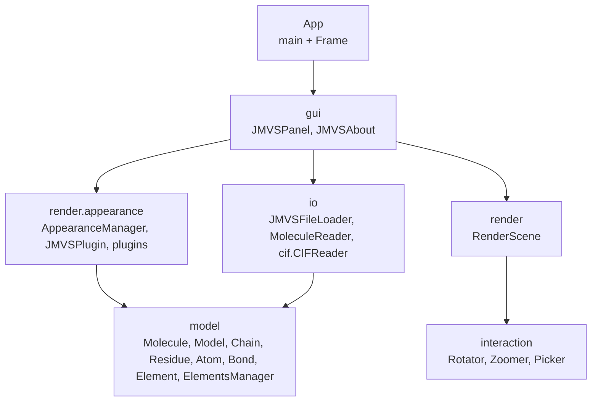
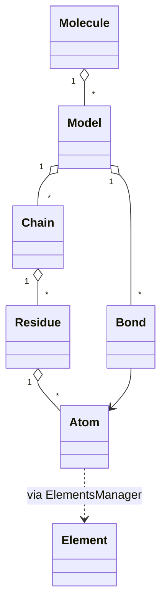

# 05 Building block view

## Level 1

| Block | Responsibility | Java3D dependency |
|---|---|---|
| `App` | Creates frame, loads `jmvs.properties`, hosts `JMVSPanel`. `System.exit` on config errors. | none |
| `gui.JMVSPanel` | Builds menus (Data, Plugins → mode → paint), owns `RenderScene` + `AppearanceManager`, current molecule/mode/paint; re-renders on menu action. | `Canvas3D` (via scene) |
| `io` | `JMVSFileLoader` (AWT `ActionListener` + `FileDialog`) calls `MoleculeReader.read(File)`; only implementation `CIFReader` (hard-coded `new CIFReader()`). | none |
| `model` | Molecule → Model(s) → Chain → Residue → Atom; `Bond`; bounds/centroid; covalent-bond detection (O(n²)); `ElementsManager` singleton (static state) loads `elements.properties`. | none |
| `render.RenderScene` | `SimpleUniverse`, `Canvas3D`, scene root, lights, `Switch`, mouse behaviours, view clip/centering. | **Heavy** |
| `render.appearance` | `AppearanceManager`: instantiates plugins, dispatches `render()`, allocates random chain colours. | `TransformGroup` in API |
| Plugins `balls`, `sticks`, `ballsandsticks`, `ribbons` | Build geometry + materials per mode. `balls` includes vendored `Sphere`/`Primitive`/`GeomBuffer` (Sun code). `ribbons` has spline curves and an (inactive) GLSL `ShaderAppearance`. | **Heavy** |
| `interaction` | `Rotator`/`Zoomer` extend Java3D `MouseRotate`/`MouseZoom`; `Picker` extends `PickMouseBehavior` (unused). | **Heavy** |

## Key interface

`JMVSPlugin`: `getName/getAuthor/getVersion/getInformation`, `init(Properties)`, `setPaintMode`, `render(Molecule) : TransformGroup`, `getPaintModes()`, `paint(TransformGroup, String)` (no-op in Balls; call commented out in `AppearanceManager`).

## Domain model

Notes: sheet/helix membership is stored as flags on `Residue`; `isTurnPart` is read by plugins but the reader never sets it (only a setter exists, no callers found), so turns are never coloured.
