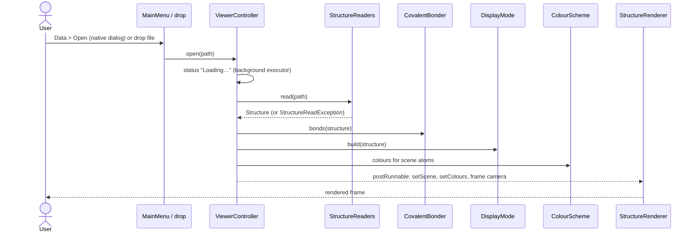

# 06 Runtime view

## Startup

```mermaid
sequenceDiagram
    participant L as Launcher
    participant A as JmvsApplication
    participant C as ViewerController
    participant R as StructureRenderer
    L->>L: parse options; on macOS restart with -XstartOnFirstThread if needed
    L->>A: new Lwjgl3Application(app, config: GL 3.2 core)
    A->>A: GLSL #version 150 prepends; VisUI skin
    A->>R: create (compile shaders from classpath)
    A->>C: create with Registry (ViewerConfig, ColourTables) and readers (ElementTable)
    A->>A: build Scene2D stage (menus from registry ids/names), input multiplexer
```

A configuration error is logged and the launcher exits with a non-zero status; the launcher is the only place the JVM is exited.

## Open and display a structure



On `StructureReadException` the controller posts an error dialog and keeps the previous structure.

## Change colour scheme

Menu → `ViewerController.setScheme(id)` → compute a colour per instance/vertex → `StructureRenderer.setColours` (buffer update only, no geometry rebuild).

## Change display mode

Menu → `ViewerController.setMode(id)` → use cached `Scene` for that mode or build it → `setScene` + `setColours`. Camera is not reset.

## Change secondary structure source

*Display* menu (or `--ss`) → `ViewerController.setSecondaryStructureSource(source)` → on the background executor,
`SecondaryStructures.apply` to the structure as read (computing with `DsspAssigner` for *Computed*, or *Auto* on an
unannotated file) and build the current mode's scene → `postRunnable`: cached scenes replaced, `sceneChanged` with
fresh colours. Atom indices are unchanged, so the selection and surface stay. Opening a file applies the chosen source
during the load.

## Show a surface

*Surface* menu (or `--surface`) → `ViewerController.setSurface(kind)` → cached `Surface` for that kind, or status
"Computing surface…" while `SurfaceBuilder` runs on the background executor → `postRunnable`: `StructureRenderer.setSurface`.
A newer request (other kind, None, another file) bumps a generation counter; the superseded build stops at its next
check and its result is dropped. Opening a file keeps the chosen kind and rebuilds it for the new structure. Colour
scheme changes recolour the surface with the scene; opacity changes only set a uniform.

## Show a density map

File > Open, drag-and-drop, a positional `.map`/`.mrc`/`.ccp4` file or `--map` → `ViewerController.openMap` →
`MrcMapReader` on the background executor → `postRunnable`: the map is kept and the level set to `--contour` or
`density.sigma` σ → `IsosurfaceBuilder` and `ZoneColouring` in the background → `StructureRenderer.setDensity`.
Moving the contour slider or pressing `[` / `]` starts a new build; a generation counter stops superseded builds and
the previous contour stays on screen until the new one arrives. Opening another structure keeps the map: the contour
is shown in the map colour, then re-zoned for the new atoms without re-meshing. Without a structure, the camera frames
the first contour.

## Pick an atom

Click (without drag) → `ScreenPicker` casts a ray, `Picking` finds the nearest pick target → controller updates selection → renderer sets the highlight flag; status bar shows atom details. Clicking empty space or pressing Esc clears the selection.
