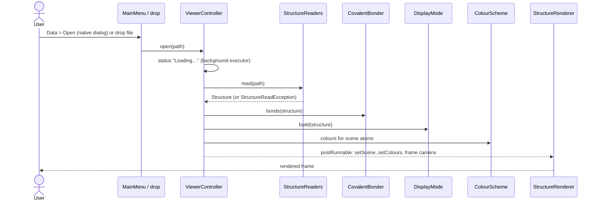

# 06 Runtime view

## Startup

```mermaid
sequenceDiagram
    participant L as Launcher
    participant A as JmvsApplication
    participant C as ViewerController
    participant R as StructureRenderer
    L->>L: parse options; on macOS restart with -XstartOnFirstThread if needed
    L->>A: new Lwjgl3Application(app, config: GL 3.2 core)
    A->>A: GLSL #version 150 prepends; VisUI skin
    A->>R: create (compile shaders from classpath)
    A->>C: create with Registry (ViewerConfig, ColourTables) and readers (ElementTable)
    A->>A: build Scene2D stage (menus from registry ids/names), input multiplexer
```

A configuration error is logged and the launcher exits with a non-zero status; the launcher is the only place the JVM is exited.

## Open and display a structure



On `StructureReadException` the controller posts an error dialog and keeps the previous structure.

## Change colour scheme

Menu → `ViewerController.setScheme(id)` → compute a colour per instance/vertex → `StructureRenderer.setColours` (buffer update only, no geometry rebuild).

## Change display mode

Menu → `ViewerController.setMode(id)` → use cached `Scene` for that mode or build it → `setScene` + `setColours`. Camera is not reset.

## Pick an atom

Click (without drag) → `ScreenPicker` casts a ray, `Picking` finds the nearest pick target → controller updates selection → renderer sets the highlight flag; status bar shows atom details. Clicking empty space or pressing Esc clears the selection.
