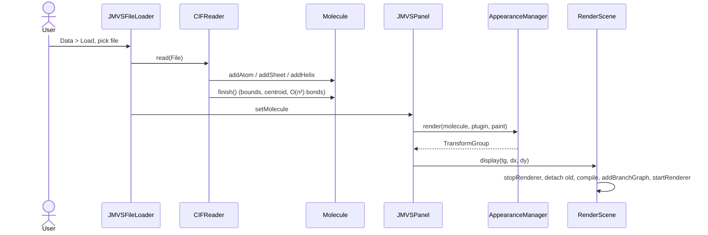

# 06 Runtime view

## Startup

```mermaid
sequenceDiagram
    participant M as App.main
    participant P as JMVSPanel
    participant A as AppearanceManager
    participant S as RenderScene
    M->>M: load jmvs.properties (classpath; exit on failure)
    M->>P: new JMVSPanel(frame, props)
    P->>A: new (ElementsManager.initialise)
    P->>A: initialisePlugins(plugin.list)
    A->>A: Class.forName(...).newInstance(), init(props)
    P->>P: build menus from plugin paint modes
    P->>S: new RenderScene (Canvas3D + SimpleUniverse)
    M->>M: setVisible(true)
```

Default mode/paint are hard-coded to `Balls`/`CPK` in `AppearanceManager` (the properties `plugin.default.*` and `molecule=` are not read).

## Load and render a molecule



## Change mode/paint

Menu item → `JMVSPanel.actionPerformed` (menu label = plugin name, item = paint mode) → full re-render of the geometry (no incremental recolouring) → `RenderScene.display`.

## Parsing (CIFReader)

Line-by-line: lines starting `_atom_site.`, `_struct_conf.`, `_struct_sheet_range.` register column indices; subsequent data rows are split on whitespace and dispatched by reflection to the private method named after the category (`_atom_site(...)`). Any exception → stack trace and `System.exit(0)`.

## Error handling

Mostly `printStackTrace` + stdout messages; hard exits on config/parse failure; loader failure is only logged.
