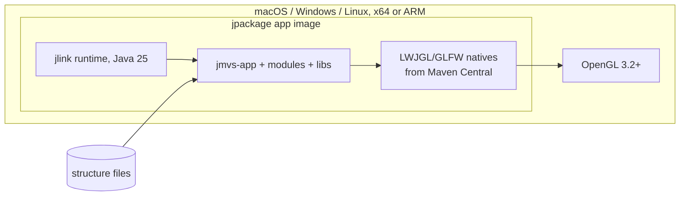

# 07 Deployment view

Single-process desktop application; no server components.

| Aspect | Target state | ADR |
|---|---|---|
| Build | `./gradlew build` (toolchains provision JDK 25) | [0001](../adr/0001-java-25-gradle-9-toolchains.md) |
| Run (dev) | `./gradlew :jmvs-app:run --args="data/1crn.cif"`; archived legacy app: `./gradlew -p legacy-app run` (macOS only) | [0003](../adr/0003-strangler-migration-legacy-module.md) |
| Start scripts | `./gradlew :jmvs-app:installDist` → `jmvs-app/build/install/jmvs/bin/jmvs` (needs a Java 25+ runtime) | |
| Packaging | `./gradlew :jmvs-app:jpackage`: jlink runtime + jpackage, `.dmg` (macOS), `.msi` (Windows), `.deb` (Linux) in `jmvs-app/build/jpackage/` | [0013](../adr/0013-ci-and-native-packaging.md) |
| CI | GitHub Actions on Ubuntu, macOS, Windows; non-blocking latest-JDK job | [0013](../adr/0013-ci-and-native-packaging.md) |
| Release | Installers attached to GitHub releases on version tags | [0013](../adr/0013-ci-and-native-packaging.md) |
| Platforms | macOS (Apple Silicon, Intel), Windows x64, Linux x64; ARM Linux/Windows best-effort | [0004](../adr/0004-libgdx-rendering-engine.md) |
| Signing | Not signed; macOS users must allow the app in Gatekeeper | [0013](../adr/0013-ci-and-native-packaging.md) |
| Sample data | `data/` in the repo; not bundled in installers | |
