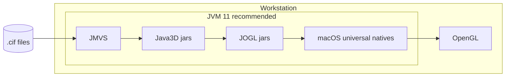

# 07 Deployment view

Single-process desktop JVM application; no server components.

| Aspect | Current state |
|---|---|
| Build | `gradle build` (README); wrapper present, so `./gradlew build` |
| Run | `gradle run`; the relative shader/test paths imply the working directory is `app/` **[Assumption: Gradle uses the project dir]** |
| Packaging | None beyond Gradle `application` distributions; vendored jars are included via `fileTree` |
| Platforms | macOS (Apple Silicon/universal) only as shipped; Windows/Linux need own JOGL natives |
| CI/CD | None |
| Tests | JUnit 5: `CIFReaderTest` (1crn: 1 model, 1 chain, 46 residues, 327 atoms) and a stub `AppTest`; no rendering tests |
| Sample data | `data/` (not on the classpath); `1crn.cif` duplicated in main and test resources |
