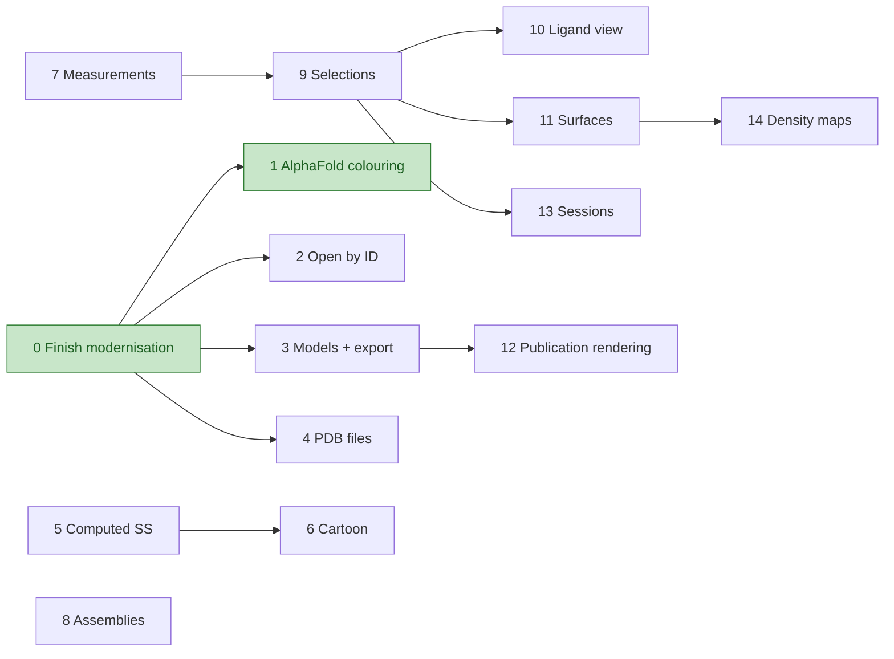

# JMVS feature roadmap

Ordered feature slices drawn from the ranked gaps in the [SWOT analysis](swot.md). Each slice is a vertical piece of
work a user can see, small enough to plan, build and release on its own. Work through them in order unless a
dependency or new information says otherwise; update this file as slices complete or change.

Effort is relative: **S** small, **M** medium, **L** large. Each slice that makes an architectural decision gets an
ADR in [`adr/`](adr/README.md) and updates to the affected [arc42](README.md#to-be-arc42) sections.

## Status

Status values: ✅ **Done** (merged, with the release or PR noted), 🚧 **In progress** (link the PR or branch),
⏳ **Planned**. When a slice starts or finishes, update its row in the overview, its node class in the diagram, and
the *Status* line at the end of its section in the same pull request as the work.

## Overview

| # | Slice | Theme | Value | Effort | Depends on | Status |
|---|---|---|---|---|---|---|
| 0 | Finish the modernisation | Foundation | High | M | — | ✅ Done ([#2](https://github.com/PorridgeBear/jmvs/pull/2), `v2.0.0`) |
| 1 | AlphaFold-ready colouring | Predicted models | High | S | 0 | ✅ Done ([#3](https://github.com/PorridgeBear/jmvs/pull/3)) |
| 2 | Open by ID | Getting data | High | S | 0 | ⏳ Planned |
| 3 | Models and image export | Everyday use | Medium | S | 0 | ⏳ Planned |
| 4 | Legacy PDB files | Getting data | Medium | S | 0 | ⏳ Planned |
| 5 | Computed secondary structure | Predicted models | High | M | — | ⏳ Planned |
| 6 | Cartoon representation | Visualisation | High | M | 5 | ⏳ Planned |
| 7 | Measurements and labels | Analysis | High | M | — | ⏳ Planned |
| 8 | Biological assemblies | Biological context | High | M | — | ⏳ Planned |
| 9 | Selections and mixed representations | Analysis | High | L | 7 | ⏳ Planned |
| 10 | Ligand and binding-site view | Biological context | High | M | 9 | ⏳ Planned |
| 11 | Molecular surfaces | Visualisation | High | L | 9 | ⏳ Planned |
| 12 | Publication-quality rendering | Output | Medium | M | 3 | ⏳ Planned |
| 13 | Sessions and scripting | Reproducibility | Medium | L | 9 | ⏳ Planned |
| 14 | Density maps | Cryo-EM | Medium | L | 11 | ⏳ Planned |
| — | Watch items: Metal rendering on macOS; very large structures | Platform | Medium | L | — | Watching |

## Slices

### 0. Finish the modernisation

Close the open items in [modernisation.md](modernisation.md) so new features build on a released, cross-platform
base.

- Run CI on GitHub; fix anything platform-specific.
- Install and try the Windows and Linux installers; check quality scenarios on one of them.
- Parity sign-off against the legacy screenshots, then archive `legacy-app/` as a standalone build outside the root build and CI (cutover). It is kept for posterity rather than deleted.
- First tagged release (`v2.0.0`) with installers.

**Done when** a GitHub release has working installers for macOS, Windows and Linux and `legacy-app/` is no longer part of the build.

**Status: done** ([#2](https://github.com/PorridgeBear/jmvs/pull/2)). CI passes on all three OSes, each installer is smoke-tested in the release workflow, and `v2.0.0` is released.

### 1. AlphaFold-ready colouring

Make predicted models useful: colour by model confidence.

- Read `B_iso_or_equiv` into `Atom` (core).
- Add a **B-factor** colour scheme (blue → red gradient) and a **Confidence (pLDDT)** scheme using AlphaFold's bands:
  very high (> 90), confident (70–90), low (50–70), very low (< 50).
- Show the B-factor/pLDDT of the selected atom in the status bar.
- Add an AlphaFold DB sample to `data/` with golden values.

**Done when** an AlphaFold model opens coloured by pLDDT, matching the AlphaFold DB website's bands.

**Status: done** ([#3](https://github.com/PorridgeBear/jmvs/pull/3)). B-factor and Confidence (pLDDT) colour schemes with legends, the picked atom's value in the status bar, and an AlphaFold DB sample (`AF-P69905-F1`) with golden values ([ADR 0016](adr/0016-bfactor-confidence-colouring-and-legends.md)). Not yet released.

### 2. Open by ID

Open structures without downloading files by hand.

- *File > Open ID…*: accepts a PDB ID (e.g. `4hhb`, and extended `pdb_0000xxxx` IDs) or an AlphaFold DB ID
  (e.g. `AF-P69905-F1`).
- Download BinaryCIF from RCSB (fall back to mmCIF) and mmCIF from AlphaFold DB over HTTPS, in the background, with
  progress and errors in the UI; cache downloads locally.
- Accept an ID on the command line too.
- ADR: first network access (context view, security, offline behaviour).

**Done when** `4hhb` and an AlphaFold ID open from the dialog, and offline use shows a clear error.

**Status: planned.**

### 3. Models and image export

Small everyday gaps.

- **Model picker**: *View > Model* shows one model at a time (default: first) or all overlaid.
- **Export image**: *File > Export image…* saves a PNG of the view at window size or a chosen larger size, without
  the UI overlay. Reuse the `--screenshot` code.

**Done when** `1d3z` can be stepped through model by model and a 4K PNG can be exported from the menu.

**Status: planned.**

### 4. Legacy PDB files

Read `.pdb` files, still common in teaching material and older datasets.

- `PdbStructureReader` in `jmvs-core` (fixed-column `ATOM`/`HETATM`, `HELIX`, `SHEET`, `MODEL`), registered in
  `StructureReaders`.
- Golden test: a PDB version of an existing sample gives the same counts as its mmCIF.

**Done when** `1crn.pdb` and `1crn.cif` load identically.

**Status: planned.**

### 5. Computed secondary structure

Ribbons and structure colouring currently depend on helix/sheet annotations in the file, which predicted models
and some files lack.

- Implement a DSSP-style assignment from backbone hydrogen bonds in `jmvs-core`.
- Use it when the file has no annotation; optionally let the user choose *file* or *computed*.
- Test against the file annotations of the samples (agreement threshold, not exact match).

**Done when** an AlphaFold model shows helices and sheets in ribbons and structure colouring.

**Status: planned.**

### 6. Cartoon representation

The representation most users expect, built on the existing ribbon code.

- Sheet arrows at strand ends; helices as wide ribbons or cylinders; thin tube for coil.
- Ribbon thickness (not flat strips).
- Nucleic acid backbones (through phosphates) with simple base blocks or sticks.
- Keep the flat legacy Ribbons mode for RasMol parity.

**Done when** `4hhb`, `1usc` and a DNA structure render as cartoons with arrows and tubes.

**Status: planned.**

### 7. Measurements and labels

First analysis tools, building on picking.

- Pick two, three or four atoms to measure distance, angle or dihedral; draw lines and value labels in the scene.
- Atom and residue labels for selected atoms.
- *View > Clear measurements*.

**Done when** a distance and an angle can be measured and labelled on `1crn` and match a reference viewer.

**Status: planned.**

### 8. Biological assemblies

Show proteins as they exist biologically, not just the asymmetric unit.

- Read `pdbx_struct_assembly`, `pdbx_struct_assembly_gen` and `pdbx_struct_oper_list`.
- *View > Assembly*: asymmetric unit or assembly 1…n. Render copies as transformed instances, so geometry isn't
  duplicated.
- ADR: how assemblies are represented in the model and scene.

**Done when** a multi-copy assembly (e.g. a virus capsid or homo-oligomer) renders as the full assembly.

**Status: planned.**

### 9. Selections and mixed representations

The foundation for most advanced features.

- Selection model: by chain, residue range, residue name, ligand, water, element, or picked atoms; and/or/not.
- A simple selection panel in the UI, and a text syntax (RasMol-like, e.g. `select ligand`).
- Different display mode and colour per selection; hide/show.
- ADR: selection model and how scenes are composed from several modes.

**Done when** a protein can be shown as cartoon with its ligand as balls-and-sticks and waters hidden.

**Status: planned.**

### 10. Ligand and binding-site view

A common task: look at what a ligand touches.

- *Focus ligand*: zoom to a ligand and show residues within a distance as sticks.
- Show hydrogen bonds and close contacts as dashed lines.
- List ligands in the UI.

**Done when** focusing the haem in `4hhb` shows the surrounding residues and hydrogen bonds.

**Status: planned.**

### 11. Molecular surfaces

- Solvent-excluded and solvent-accessible surfaces computed in the background (e.g. marching cubes on a distance
  field).
- Colour surfaces with the existing schemes; transparency; per-selection surfaces.
- Later: hydrophobicity and electrostatic colouring.

**Done when** `4hhb` shows a smooth surface in under a few seconds and can be coloured by chain.

**Status: planned.**

### 12. Publication-quality rendering

- Screen-space ambient occlusion and outlines (silhouettes); background colour choice.
- Colour-blind-safe chain palette option.
- Export: transparent background; rotation movie as image sequence or video.

**Done when** exported images are suitable for a figure without editing.

**Status: planned.**

### 13. Sessions and scripting

- Save and restore a session: file or ID, view, representations, selections, colours, measurements.
- A small command language (building on the selection syntax) runnable from a console or a script file.
- Command-line batch rendering from a script.

**Done when** a session can be saved, reopened identically, and reproduced from a script.

**Status: planned.**

### 14. Density maps

- Read MRC/CCP4 maps (and fetch EM maps by EMDB ID).
- Isosurface at an adjustable contour level, overlaid on the model; mesh or surface.

**Done when** an EM map and its fitted model display together with an adjustable contour.

**Status: planned.**

## Watch items

Not scheduled; revisit when they become blocking.

- **Metal rendering on macOS.** Apple has deprecated OpenGL. libGDX's ANGLE route offers only OpenGL ES 2.0 on macOS
  today, while JMVS's instanced rendering needs ES 3. Track libGDX/ANGLE; if needed, add a non-instanced fallback
  renderer as another `jmvs-render-*` module ([ADR 0002](adr/0002-multi-module-build.md)).
- **Very large structures (millions of atoms).** Level of detail, impostor spheres, and culling; triggered by slice 8
  (assemblies) or user demand.
- **Web version.** The renderer-neutral scene model would allow it, but the file reader and the libGDX web backends
  would need investigation.
